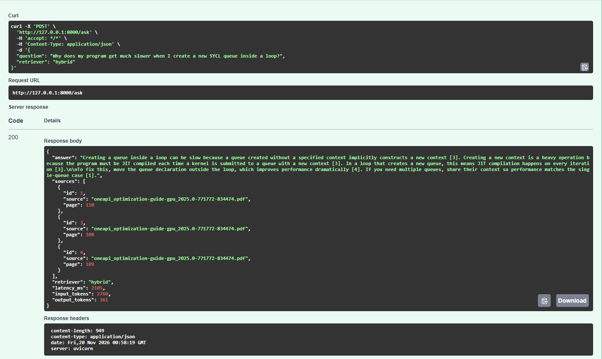
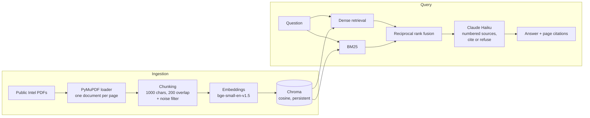

# GPU DevAssist

[](https://github.com/aishvadla/gpu-dev-assist/actions/workflows/ci.yaml)

**A retrieval-augmented generation (RAG) assistant that answers GPU programming questions from Intel's public oneAPI documentation, with page-level citations and a measured, expert-verified evaluation.**

Built by a GPU software engineer: the evaluation questions and gold labels come from domain knowledge, and the most instructive failure (dense retrieval confusing *shared local memory* with *Unified Shared Memory*) was caught because of it.

**[Results](#results) · [Why hybrid retrieval](#why-hybrid-retrieval-a-real-failure) · [Architecture](#architecture) · [Quick start](#quick-start) · [Evaluation report](docs/evaluation.md)**



---

## Results

Evaluated on **50 questions** (43 answerable with gold pages verified against the source PDFs, 7 unanswerable). Full methodology and failure analysis: [docs/evaluation.md](docs/evaluation.md).

**Retrieval** (43 answerable questions)

| Retriever | Hit@5 | Recall@5 | MRR@10 |
|---|---|---|---|
| Dense (`bge-small-en-v1.5`) | 0.65 | 0.54 | 0.49 |
| BM25 (stemmed) | 0.79 | 0.65 | 0.58 |
| **Hybrid (reciprocal rank fusion), default** | **0.81** | **0.67** | **0.67** |

On 10 questions worded the way developers actually ask (avoiding the documents' terms), Hit@5 was **hybrid 0.70**, BM25 0.50, dense 0.50.

**Answers** (hybrid retriever, all 50 questions)

| Metric | Result |
|---|---|
| Answered when answerable | 40 / 43 |
| Refused when unanswerable | **7 / 7** (no fabricated answers) |
| Citation hit (cites a gold page) | 0.88 |
| Faithfulness (claims supported by retrieved text) | 0.98 |

**Key findings**
- **Keyword matching is essential for this corpus.** Dense retrieval alone was weakest: best on conceptual questions (7/7) but it missed exact identifiers (`warp`, `sycl-ls`, `local_mem_size`) and confused domain terms.
- **Hybrid wins where it matters, and the test was set up before the result.** On questions that reuse the documents' wording, stemmed BM25 and hybrid tied (0.88 vs 0.85). To test whether hybrid handles real-world wording better, I added 10 user-style questions and recorded the prediction before running: hybrid found 7, BM25 5. Hybrid kept every question BM25 found and added the two only dense found, because the retrievers fail on different questions. Its cost: on some paraphrased questions, fusion demotes a page only BM25 found.
- **Stemming fixed a diagnosed miss.** "prefetching" didn't match "prefetch"; after adding Snowball stemming, that page rose from rank 7 to rank 1 in hybrid.
- **Every answer-level failure traces back to retrieval.** When the relevant page wasn't retrieved, the model refused or answered from the context it had, rather than inventing. The bottleneck is retrieval, which is where further work should go.
- **Answers are grounded but can be incomplete:** supported-claim metrics don't measure completeness (see the evaluation write-up).

---

## Why hybrid retrieval: a real failure

Asked *"When should I use shared local memory in a SYCL kernel?"*, the dense retriever returned pages about **Unified Shared Memory** (`malloc_shared`), an unrelated concept that shares the word "shared". The model correctly refused, because nothing it was given answered the question.

| | Dense | BM25 | Hybrid |
|---|---|---|---|
| Shared local memory pages in top 10 | 0 | 6 | ✓ |
| Answer | Refused | Answered | Answered, cited |

A general-purpose embedding model treats the two terms as similar; to a GPU engineer they aren't. BM25 matches the exact term, and reciprocal rank fusion combines both rankings so that results ranked well by both rise to the top.

---

## Architecture



**Design decisions**

| Decision | Reason |
|---|---|
| Chunk within pages | Every chunk keeps its page number, so citations point to a real page |
| Noise filter (title and table-of-contents chunks) | They matched query words but carried no content, crowding real answers out of the top results |
| `bge-small-en-v1.5` instead of `all-MiniLM-L6-v2` | MiniLM's 256-token limit truncated 42% of chunks before embedding; bge-small's 512-token limit fits them |
| Hybrid retrieval with reciprocal rank fusion | Combines rankings without normalizing incompatible scores (cosine distance vs BM25) |
| Snowball stemming in BM25 | Word forms match ("prefetching" → "prefetch"); identifiers like `local_mem_size` stay single tokens |
| The model cites `[n]`; code maps `[n]` to source and page | The model never writes page numbers, so it can't invent them |
| Exact refusal sentence | Refusals are checked by code, not by a judge |
| One retriever interface (`query_retrieve`) | Dense, BM25 and hybrid are interchangeable in the generator, CLI, API and evaluation |

Every decision was made from a measurement; the full record is in [docs/experiment_log.md](docs/experiment_log.md).

---

## Quick start

Requires Python 3.13, [uv](https://docs.astral.sh/uv/) and an [Anthropic API key](https://console.anthropic.com/).

**1. Install**
```bash
git clone https://github.com/aishvadla/gpu-dev-assist.git
cd gpu-dev-assist
uv sync
```

**2. Configure**: create `.env` in the repo root:
```
ANTHROPIC_API_KEY=your-key
```

**3. Download the documents**: the PDFs are not redistributed. Download the two guides listed in [data/sources.md](data/sources.md) into `data/raw/`.

**4. Build the index**
```bash
uv run gpu-dev-assist ingest
```

**5. Ask**
```bash
uv run gpu-dev-assist ask "Why is my program slower when I create a new SYCL queue inside a loop?"
uv run gpu-dev-assist ask "What is NVIDIA's CUDA warp size?" --retriever dense   # compare retrievers
```

## API

```bash
uv run uvicorn app.app:app --reload
```
Interactive docs at http://127.0.0.1:8000/docs.

| Endpoint | Description |
|---|---|
| `POST /ask` | `{"question": "...", "retriever": "hybrid"}` → answer, cited sources (document and page), latency and token usage |
| `GET /health` | Health check |

Requests are validated (question length, retriever name); invalid input returns 422.

## Docker

Build the index locally first (step 4), then:
```bash
docker build -t gpu-dev-assist .
docker run -p 8000:8000 --env-file .env gpu-dev-assist
```
The image uses CPU-only PyTorch (the embedding model runs on CPU), which cut it from 10 GB to 2.8 GB on disk (652 MB compressed). The embedding model is downloaded at build time, so the container runs offline apart from the LLM API. The image is built locally and not published, because the index contains the documents' text.

## Evaluation

```bash
uv run gpu-dev-assist eval retrieval    # Hit@5, Recall@5, MRR@10 for all three retrievers (local, free)
uv run gpu-dev-assist eval generation   # refusals, citation hit, faithfulness (calls the API)
uv run pytest -v                        # unit tests (LLM mocked; no API key needed)
```

The evaluation set is [data/eval/questions.jsonl](data/eval/questions.jsonl): conceptual, exact-term, reasoning, paraphrased and unanswerable questions, each answerable one with gold pages and a quoted excerpt checked against the PDF.

---

## Project structure

```
gpu-dev-assist/
├── app/app.py                       # FastAPI service
├── src/gpu_dev_assist/
│   ├── data_loader.py               # PDF loading
│   ├── chunking_embedding.py        # chunking, noise filter, embeddings
│   ├── vector_store.py              # Chroma store (clean rebuilds)
│   ├── data_ingestion.py            # ingestion pipeline
│   ├── dense_retrieve.py            # dense retrieval
│   ├── keyword_retrieve.py          # BM25 retrieval
│   ├── hybrid_retrieve.py           # reciprocal rank fusion + build_retrievers()
│   ├── generate.py                  # cited answers and refusals
│   ├── evaluate_retrieval.py        # retrieval metrics
│   ├── evaluate_generation.py       # answer-level metrics and LLM judge
│   └── cli.py                       # gpu-dev-assist command
├── data/eval/questions.jsonl        # evaluation set (50 questions)
├── data/sources.md                  # document sources and versions
├── docs/                            # evaluation write-up, experiment log, images
├── tests/                           # unit and contract tests
└── Dockerfile
```

## Data and licensing

Built only on **publicly available** Intel documentation (see [data/sources.md](data/sources.md)): the Intel oneAPI GPU Optimization Guide 2025.0 and the Intel oneAPI Programming Guide 2025.1. The documents are not redistributed in this repository or in any published image; answers quote short passages with page references. Code is MIT-licensed.

## Limitations

- **Small evaluation set** (50 questions): differences of one or two questions per category are not meaningful.
- **Gold labels** were found by keyword search and manual review; a relevant page with entirely different wording could be unlabeled.
- **Completeness isn't measured:** answers can be grounded and correctly cited but narrow.
- **The faithfulness judge** is from the same model family as the generator, and generation metrics come from a single run.

## Next steps

- **Retrieval:** weighted fusion (favour BM25), a cross-encoder reranker, structure-aware chunking (section headings, whole code blocks).
- **Evaluation:** more user-style questions (ideally from real users), answer correctness against reference answers; latency and cost per query in the evaluation report.
- **Engineering:** a document download command, API tests, a 503 response when the LLM API is unavailable.
- **Deployment:** hosted API with rate limiting.
- **Coverage:** the Khronos SYCL 2020 specification.
